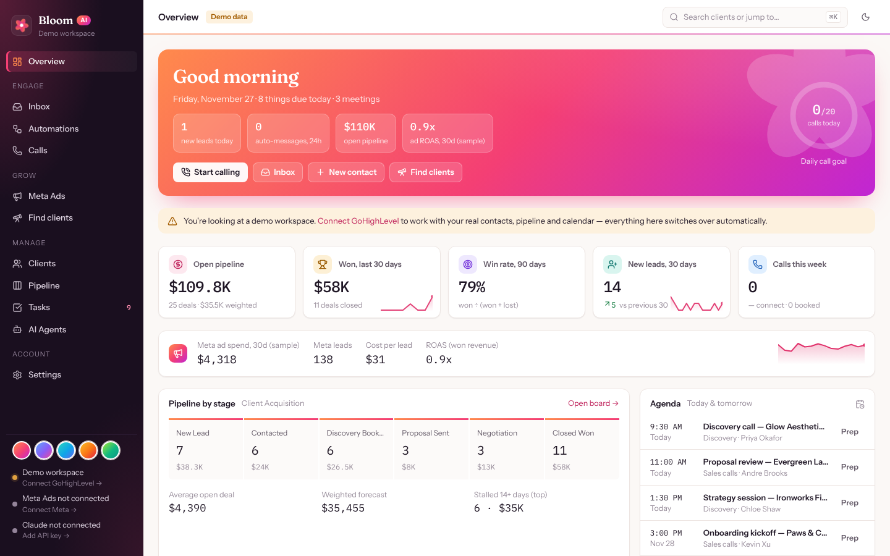
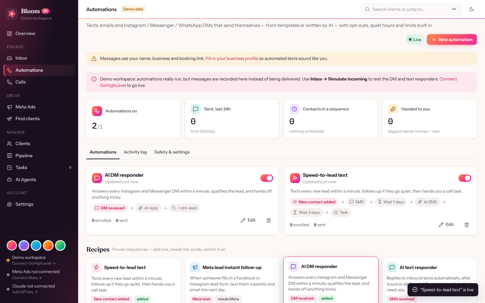
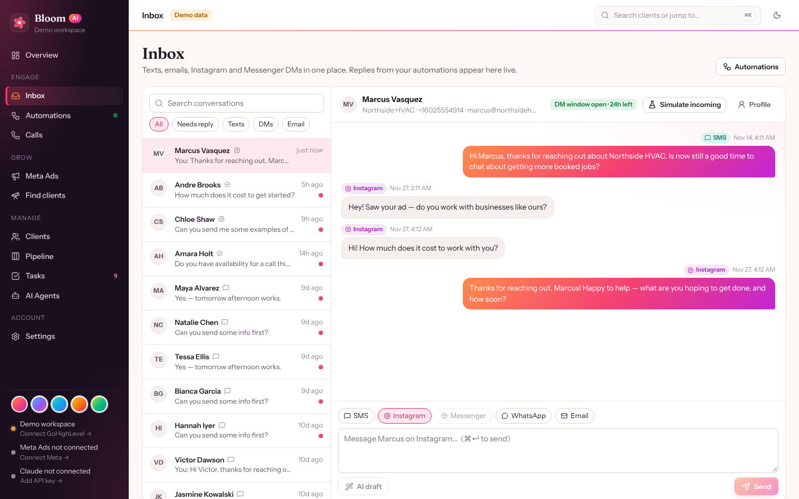
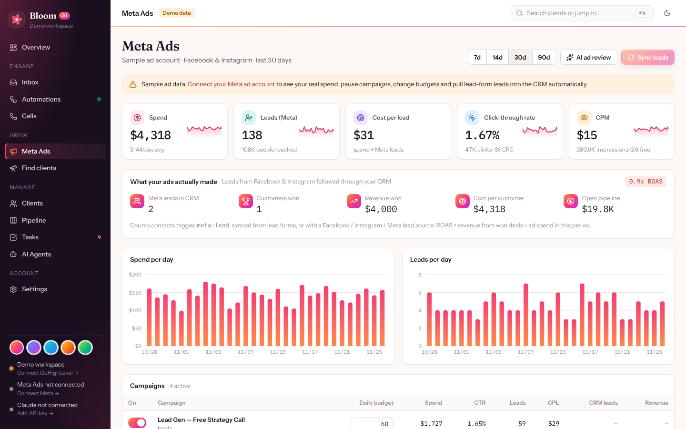

# Bloom AI

Bloom AI is a client command center built on the Agency Agents roster. It finds new clients and manages the ones you have. It answers texts and Instagram / Messenger DMs on autopilot, runs your calls, and follows your Meta ads all the way to the revenue they bring in. It connects to **GoHighLevel** and **Meta**.



## What's inside

| Area | What you get |
|---|---|
| **Overview** | A gradient hero with your daily call-goal ring, today's leads, how many messages your automations sent, open pipeline and ad ROAS. KPI cards with sparklines, a Meta Ads summary, the stage funnel, an agenda, tasks due, deals going cold and lead sources |
| **Inbox** | Every conversation in one place: SMS, email, Instagram DMs, Messenger and WhatsApp. Reply on any channel, have the AI draft a reply, and see the live 24-hour DM window. Automated replies appear as they happen. The demo workspace can simulate incoming messages |
| **Automations** | Sequences that send texts, emails and DMs **automatically**, either from templates or written by Claude. Triggers: new contact, Meta lead form, message received, tag added, stage change, deal goes quiet, call logged, manual. Steps: send, wait, tag, task, move deal. Includes recipes, a visual builder, a preview against a real contact, an activity log, and safety settings |
| **Meta Ads** | **Create and launch lead-ad campaigns** for your own business or a client's: audience, image, AI-written copy, lead form and budget on one page. Spend, leads, cost per lead, CTR and CPM with daily charts. **What the ads actually made**: Meta leads in the CRM, customers won, revenue, ROAS and cost per customer. Pause or turn on campaigns and edit daily budgets inline. Lead Ads sync into the CRM, and an AI ad review |
| **Clients (CRM)** | People and Companies views, smart and saved views, filters, bulk actions, CSV import, a duplicate finder, owners and custom fields |
| **Pipeline · Tasks · Calls** | Drag-and-drop deals (with confetti when one is won), an account-wide task list, and a ranked call queue with a live call workspace |
| **Find clients** | Google Places search, opportunity scoring, website audits, and one-click import into GoHighLevel |
| **AI Agents** | All 283 agents in this repo, available to chat with or wired into playbooks, with a client's CRM history attached |

Pick from five colour themes (Rose, Violet, Ocean, Sunset, Forest) in the sidebar. Dark mode follows your system or the top-bar toggle.



## Automated texts and DMs

Each automation is a trigger plus a list of steps. A send step goes out on **SMS, Email, Instagram, Messenger or WhatsApp**, or as a **reply on the same channel** the person used. Its content is either a template with merge fields (`{{first_name}}`, `{{company}}`, `{{my_name}}`, `{{agency}}`, `{{booking_link}}` …) or written by Claude. AI steps use one of the repo's agents (Sales Outreach by default), your business profile, and the full conversation history.

Ready-made recipes:

| Recipe | What it does |
|---|---|
| Speed-to-lead text | Texts a new lead within a minute → nudges after a day → gives you a call task |
| Meta lead instant follow-up | A Facebook / Instagram lead form is filled in → instant text → email the next day |
| AI DM responder | Answers every Instagram and Messenger DM, qualifies the lead, and tags it |
| AI text responder | Replies to inbound texts automatically |
| Revive deals going cold | A deal sits in one stage for 14 days → personal check-in → call task |
| Booked-call confirmation | A call logged as "meeting booked" → confirmation text |
| Review request after a win | A deal moves to your won stage → asks for a review a week later |

**Guardrails (always on):**
- **No cold texting:** contacts from *Find clients* (tagged `prospect`) or imported as a cold list (`cold-list`) are skipped by "new contact" automations and never get automated texts or WhatsApp messages until they agree: they text you first, or you tag them `sms-ok`. Leads who answer "No texts" on a Bloom AI lead form are tagged `no-texts` and only get emails, unless they text you first. Automated texts without consent can break US law (the TCPA) and get your number blocked by carriers. Call and email prospects instead.
- **Opt-outs:** contacts who are DND or tagged `opted-out` are never messaged. A reply of STOP, UNSUBSCRIBE, CANCEL and similar tags the contact and removes them from every sequence.
- **Meta's 24-hour rule:** Instagram and Messenger messages are only sent within 24 hours of the person's last DM. Outside that window the step is skipped and logged.
- **AI handoff:** complaints, opt-outs and questions the business profile can't answer are handed to you instead of guessed at. You get a `needs-human` tag and a task.
- **Quiet hours and limits:** scheduled messages wait for your sending window. Instant replies to someone who just messaged still go out right away. There are per-contact and daily caps.
- **Other controls:** a test mode that logs everything without sending, a master pause switch, and sequences that stop when the contact replies.

**How triggers are detected:** Bloom AI checks GoHighLevel about every 45 seconds for new contacts, tags, stage changes and messages. For instant replies, add a **Webhook** action to a GHL workflow ("Customer Replied" / "Contact Created"). The URL is under Automations → Safety & settings. GoHighLevel has to be able to reach that URL, so deploy Bloom AI or use a tunnel.

**Running time:** automations run while the Bloom AI server is running. For 24/7 automation, run it on a server or an always-on machine.



## Meta Ads



### Run ads from Bloom AI

**Meta Ads → New campaign** builds a complete Facebook (and Instagram) lead campaign in five steps:

1. **Basics:** campaign name, the ad account that pays, and the Facebook Page the ad runs under. If the Page has an Instagram account linked, the ad can run there too.
2. **Who sees it:** cities with a radius, states or ZIP codes (searched live from Meta), or the whole US, plus an age range.
3. **The ad:** upload a JPG or PNG, then write the text yourself or click **Write 3 versions**: the repo's *Paid Media Creative Strategist* agent writes three angles using only the facts you give it. A live preview shows how it looks in the feed.
4. **Lead form:** use an existing form, or create one that asks for name, email, phone, an optional question, and **"Can we text you about your request?"**. A "Yes" tags the lead `sms-ok`; a "No" tags it `no-texts`, and Bloom AI then only emails them.
5. **Budget:** a daily budget, with the monthly cost shown.

**Create paused** builds everything and leaves it off. **Create and launch** asks you to confirm the spend first. Meta reviews every new ad before it runs, usually within 24 hours. If any step fails, Bloom AI deletes the half-built campaign. Ads about housing, jobs, credit or politics have special rules, so make those in Meta Ads Manager.

**Running ads for clients:** have the client add your business as a partner on their ad account and Page (Meta Business Settings → Partners). Their accounts then appear in the builder and in the account switcher on the Meta Ads page. A client's leads go to their own CRM: connect the form in their GoHighLevel sub-account (Settings → Integrations → Facebook).

### Connect Meta

1. In **Meta Business Settings → Users → System users**, add a system user and assign it your ad account and Facebook Page.
2. Generate a token with `ads_read`, `ads_management` (needed to create campaigns, pause them and change budgets), `leads_retrieval`, `pages_show_list`, `pages_read_engagement`, `pages_manage_ads` (needed to create lead forms), `pages_manage_metadata` and `business_management`. The first time a Page runs lead ads, a Page admin has to accept Meta's Lead Ads terms at facebook.com/ads/leadgen/tos.
3. In Bloom AI, go to **Settings → Meta Ads**, paste the token, click **Test**, then pick the ad account and the Page that owns your lead forms. Turn on auto-sync to pull new leads every 5 minutes.

Leads from lead forms become GoHighLevel contacts tagged `meta-lead` (plus `facebook` or `instagram`), with every answer saved as a note. They fire your "Meta lead" automations. ROAS uses **revenue from won deals** for contacts that came from Meta, not Meta's own conversion estimate.

**DMs** are sent through GoHighLevel's Conversations API. Connect your Facebook Page and Instagram account in GoHighLevel → Settings → Integrations.

Without a Meta connection, the Ads page shows clearly labelled sample data, and the campaign builder runs in sample mode so you can try it.

## Run it

Requires Node 20+.

```bash
cd apps/bloom-ai
npm install
npm run build
npm start            # http://localhost:4400
```

For development: `npm run dev` (UI on :5173, API on :4400).

It starts in a **demo workspace** with a realistic seeded book of business. Automations really run in the demo, but messages are recorded instead of delivered. Use **Inbox → Simulate incoming** to watch the DM and text responders reply.

## Put it online (Render)

Hosting gives Bloom AI its own web address that works on any device, and keeps automations running 24/7. The repository includes a `render.yaml` blueprint, so setup is mostly clicking:

1. Go to **render.com** and sign up with **"Continue with GitHub"**.
2. In the dashboard, click **New → Blueprint**, connect GitHub if asked, and pick **quinnrude/agency-agents**. Choose the branch that has Bloom AI on it.
3. Render reads `render.yaml` and asks for **`BLOOM_PASSWORD`**. Type the password you'll use to log in (make it long; this protects your contacts and messaging).
4. Click **Apply**. The first build takes about 5 minutes.
5. Open the address Render shows (like `https://bloom-ai-xxxx.onrender.com`), log in, and connect your accounts in **Settings**.

**Cost:** Render's Starter instance (about $7/month) plus a 1 GB disk (about $0.25/month). The free plan isn't enough: it goes to sleep, which would stop your automations, and it has no disk for your settings.

**Security:** when hosted, Bloom AI requires a login and refuses to run without `BLOOM_PASSWORD`. Sessions last 30 days, and login attempts are rate-limited. The GoHighLevel webhook (Automations → Safety & settings) now has a public address you can paste into GHL workflows for instant replies.

Other hosts work too. Build with `docker build -f apps/bloom-ai/Dockerfile .` from the repository root, mount a volume at `/data`, and set `BLOOM_PASSWORD`.

## Connect your accounts

Use **Settings** in the app, or copy `.env.example` to `.env`. Values in `.env` take precedence.

- **GoHighLevel**: Sub-account → Settings → Private Integrations. Scopes needed: contacts, opportunities, calendars/events, conversations and conversation messages (read/write), and locations. Optional: users, custom fields and location tasks (read).
- **Meta**: see above.
- **Claude**: an Anthropic API key powers the AI-written messages, drafts and every agent playbook. The default model is Claude Opus 5.5.
- **Google Places**: powers *Find clients*.
- **Business profile**: your name, business, offer, pricing and booking link. Every message and agent uses it.

## Data and privacy

API keys, call logs, prospects, synced Meta leads and automation history are stored locally in `data/` (gitignored). Keys are only sent to the service they belong to, and the browser only ever sees them masked. Your CRM data stays in GoHighLevel.

## Tests

```bash
npm test            # GoHighLevel CRM (24 checks) + Meta Ads, campaign builder, automations & broadcasts (27 checks) against mock APIs
npm run typecheck
```

## Layout

```
server/
  index.ts          REST API, SSE streaming, webhooks; serves the built UI
  automations.ts    Automation engine: triggers, sequences, guardrails, recipes
  meta.ts           Meta Marketing API + Lead Ads sync
  adBuilder.ts      Campaign builder: image, lead form, campaign, ad set, creative, ad; AI ad copy
  adTemplates.ts    Button labels and plain copy templates shared with the UI and preview
  crm/ghl.ts        GoHighLevel v2 adapter (contacts, deals, tasks, conversations/DMs…)
  crm/demo.ts       Local demo CRM (same interface)
  ai.ts             Agent playbooks + AI message writing (Claude)
  agents.ts         Indexes every agent in the repo
  prospect.ts       Google Places search, scoring, website audit
src/                React UI (Vite)
test/               Mock GoHighLevel + Meta APIs and integration tests
```
