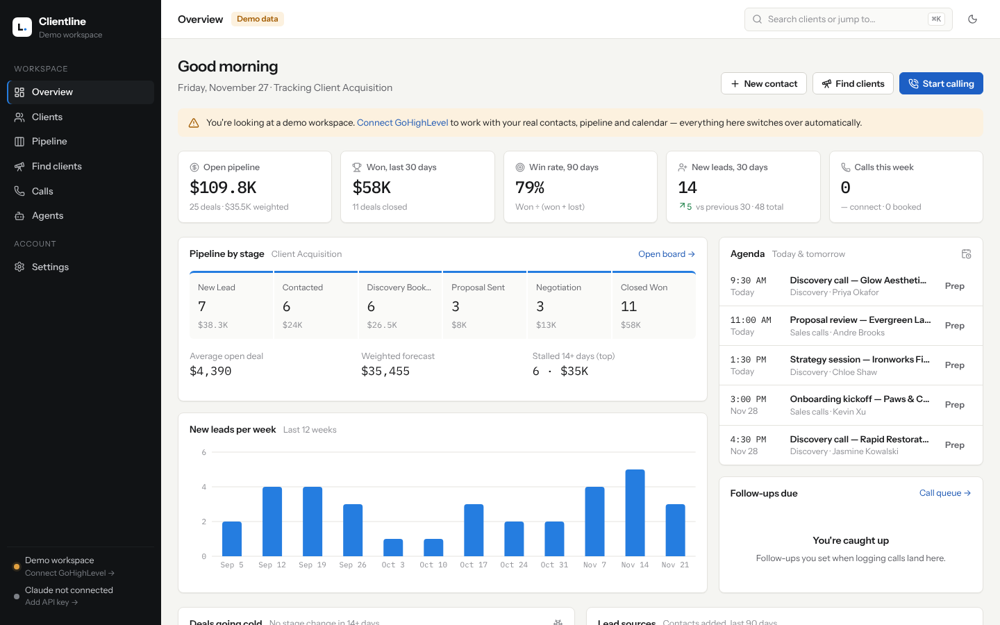
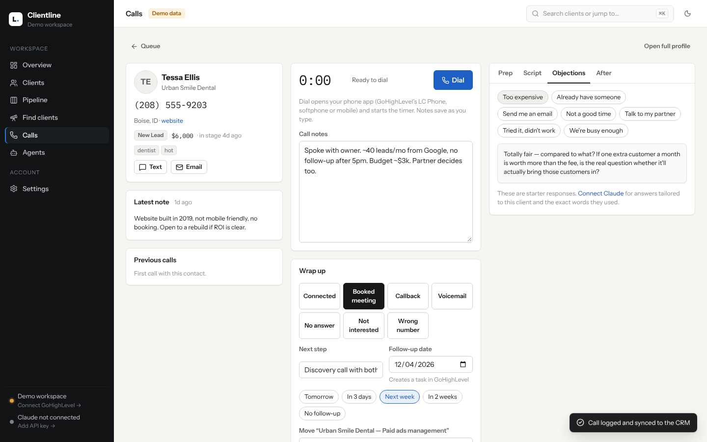

# Clientline

A client command center built on the Agency Agents roster. Use it to find new clients, track and manage the ones you have, run your calls, and put any agent in this repo to work on a specific client. It connects to **GoHighLevel**.



## What it does

| Area | What you get |
|---|---|
| **Overview** | Open pipeline and weighted forecast, 30-day wins, 90-day win rate, lead flow, calls and connect rate, a stage funnel, deals going cold, lead sources, today's GHL appointments, follow-ups due |
| **Clients (CRM)** | People and Companies views. Smart views (new this week, hot, open deals, customers, going cold, unassigned) plus your own saved views. Filters for stage, owner, source, tag and inactivity. Bulk actions: add/remove tag, assign owner, create deals, export, delete. CSV import with column mapping and duplicate skipping. A duplicate finder (shared email, phone, or name + company) |
| **Client profile** | Contact info, owner, GHL custom fields (typed editors for text, money, date and dropdown), removable tags, deals (create, edit, move stage, won/lost, delete), tasks (create, assign, edit, complete, delete), a merged activity timeline with editable notes, SMS & email sending, and agent playbooks |
| **Tasks** | Every task in the account in one list: overdue, today, next 7 days, later, completed. Filter by owner, complete in one click, push by a day or a week, edit, assign, delete. Overdue count in the sidebar |
| **Pipeline** | Drag-and-drop kanban per GHL pipeline, column totals, idle-days warnings, add or edit a deal from any column, AI pipeline review |
| **Find clients** | Search local businesses by niche and city (Google Places), score each one as an opportunity, audit its website (HTTPS, speed, mobile, lead form, booking/chat widgets, tracking pixels, staleness), then add it to GHL as a tagged contact with an audit note and a deal |
| **Calls** | A ranked call queue (follow-ups due, stage, new leads, hot tags), calling sessions that move to the next contact, a call workspace with timer and dialer, notes, a discovery checklist, objection help, and a wrap-up step that writes a note, creates a follow-up task and moves the deal in GHL. Includes call stats and history |
| **Agents** | Every agent in this repo (283), searchable by division. You can chat with any of them, with a client's CRM history attached |



### Agent playbooks

The repo's agents are wired into the screens where you need them. Each playbook uses that agent's markdown as the system prompt, plus your business profile and the client's CRM data:

| Playbook | Agent | Where |
|---|---|---|
| Call prep brief | `sales/sales-discovery-coach.md` | Client profile, call workspace |
| Cold call script | `sales/sales-outbound-strategist.md` | Call workspace |
| Live objection help | `sales/sales-coach.md` | Call workspace |
| Post-call summary | `project-management/project-management-meeting-notes-specialist.md` | Call workspace |
| Follow-up email + SMS (review & send via GHL) | `specialized/sales-outreach.md` | Client profile, call workspace |
| Proposal draft | `sales/sales-proposal-strategist.md` | Client profile |
| Deal strategy review | `sales/sales-deal-strategist.md` | Client profile |
| Account growth plan | `sales/sales-account-strategist.md` | Client profile |
| Pipeline review | `sales/sales-pipeline-analyst.md` | Pipeline |
| Prospect angle | `sales/sales-offer-lead-gen-strategist.md` | Find clients |

Any output can be copied or saved to the client as a note. Any other agent can be run from the **Agents** page.

## Run it

Requires Node 20+.

```bash
cd apps/clientline
npm install
npm run build
npm start            # http://localhost:4400
```

For development with hot reload: `npm run dev` (UI on http://localhost:5173, API on :4400).

It starts in a **demo workspace** with a realistic seeded book of business, so every screen works before you connect anything. Once you add a GoHighLevel connection, the whole app switches to your real data.

## Connect your accounts

Open **Settings** in the app, or copy `.env.example` to `.env`. Values in `.env` take precedence over values saved in the app.

**GoHighLevel** (the CRM)
1. Go to Sub-account → **Settings → Private Integrations → Create new integration**.
2. Enable these scopes: contacts (read/write), opportunities (read/write), calendars and calendar events (read), conversations and conversation messages (read/write), locations (read), and for owners, custom fields and the account-wide task list: users (read), locations/customFields (read), locations/tasks (read). The last three are optional. Without them those features hide or fall back.
3. Paste the token and your **Location ID** into Settings, then click **Test & save connection**.

Clientline uses the LeadConnector API v2 (`services.leadconnectorhq.com`, `Version: 2021-07-28`). It reads and writes contacts (including owner and custom fields), tags, notes, tasks, opportunities and pipelines, calendar events, and conversations (SMS/email), and can delete contacts, deals, notes and tasks (every delete asks you to confirm first). It backs off and retries automatically when it hits GHL rate limits.

**Claude** (the agents): add an Anthropic API key. The default model is Claude Opus 5.5, and you can switch models in Settings. Responses stream into the UI.

**Google Places** (finding clients): enable **Places API (New)** in Google Cloud and add the key. Without a key, searches return sample businesses that are clearly labelled as samples.

**Business profile**: describe what you sell, who you sell to, your pricing and your booking link. Every agent reads this, so scripts and proposals sound like you.

## Data and privacy

- API keys, call logs and prospect lists are stored locally in `data/` (gitignored). Keys are sent only to the service they belong to, and the browser only ever sees masked keys.
- Your CRM data stays in GoHighLevel. Clientline reads it live, with a short cache.
- The website auditor refuses private and local network addresses.

## Tests

```bash
npm test        # boots a mock GoHighLevel API and drives Clientline's API end to end
npm run typecheck
```

## Layout

```
server/
  index.ts          REST API + SSE streaming, serves the built UI
  crm/ghl.ts        GoHighLevel v2 adapter
  crm/demo.ts       Local demo CRM (same interface)
  agents.ts         Indexes every agent in the repo (divisions.json)
  ai.ts             Playbooks → Claude, streamed
  prospect.ts       Google Places search, scoring, website audit
src/                React UI (Vite)
test/               Mock GHL API + integration test
```
